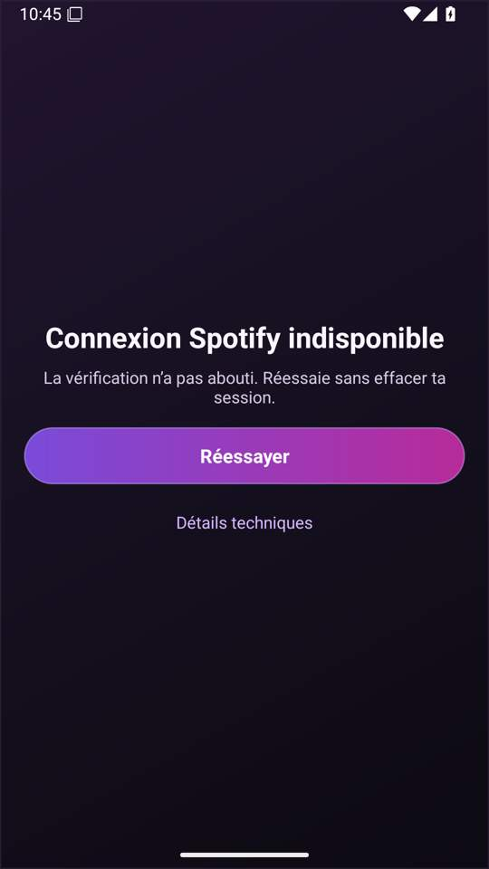
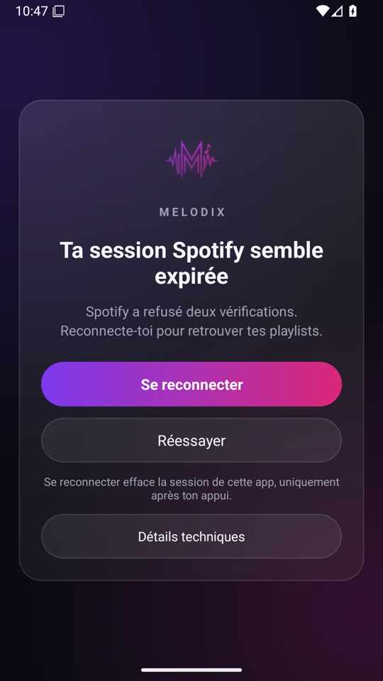
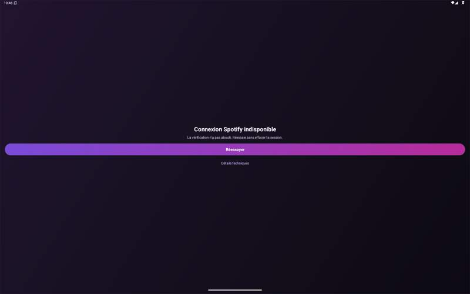
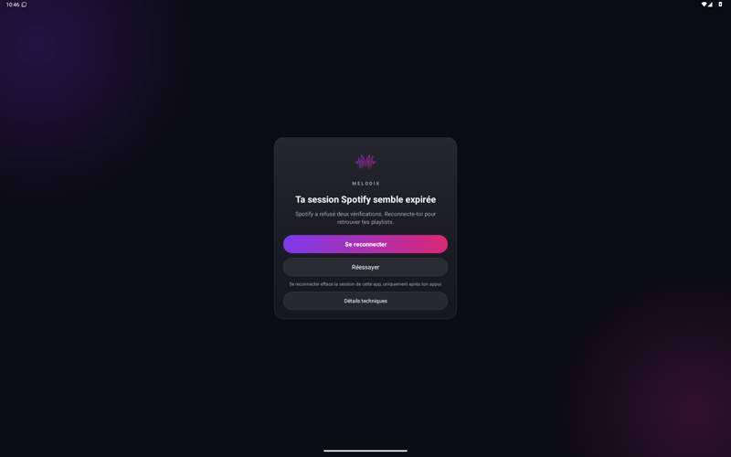

# Phase 1 — session et statuts · Preview test125

**Point d’arrêt : phase 1 uniquement.** La navigation, les écrans métier, le lecteur et le mode clair n’ont pas été refondus. La phase 2 attend le retour utilisateur.

## APK à installer

- [Télécharger l’artefact APK125 signé](https://github.com/Souxch06/Melodix/actions/runs/42602886523/artifacts/13665908696) — ouvrir le ZIP et installer l’APK, **en mise à jour de Melodix Preview**, sans désinstallation ni clear-data.
- [Build terminé avec succès](https://github.com/Souxch06/Melodix/actions/runs/42602886523).
- Package `com.melodix.music.preview` ; **versionCode 1021461**, versionName `1.2.2-2f9bca4`.
- Source applicative `2f9bca4a2e75703c598080ee7542bcf56adeccf1`.
- SHA256 APK `785df97658092bfff98dbd6396f56b92710fba2561e2c26e1f969c41a629b072`.
- L’ancien APK125 du build42602080186 est **supplanté** : utiliser le lien ci-dessus.

L’instrumentation Android a été construite sur `931d57cd` ; le diff de `res`, `smali` et `assets` depuis la source applicative ci-dessus est vide. Les commits suivants concernent les tests, workflows, exports et documentation. L’APK livré est non-debuggable ; l’instrumentation utilise sa variante debuggable, pas exactement le même binaire.

## Cause et correction

Dans124, un retour SSO pouvait armer `freshLogin` sans reconnexion volontaire. Ce drapeau court-circuitait ensuite l’analyse des refus, d’où un écran générique compatible avec le rapport400/403/401. Il n’y avait pas de confirmation sur deux tentatives. Le rapport du téléphone ne permet pas de déduire la valeur réelle du drapeau ni le nombre de tentatives.

Désormais :

| Observation | Présentation / action |
|---|---|
| Aucun cookie au lancement | Connexion officielle, au plus une ouverture automatique par lancement |
| Vérification en cours | Statut natif ; deadline de présentation3s, jamais une preuve d’expiration |
| Premier refus complet API400 + repli403 + bibliothèque401, cookie présent | Erreur réessayable, pas de suppression ni redirection automatique |
| Deux tentatives terminées distinctes, mêmes refus et même cookie | **Ta session Spotify semble expirée** ; **Se reconnecter** principal, **Réessayer** secondaire |
| Tap Se reconnecter | Recontrôle de l’identité du cookie ; suppression autorisée seulement si les deux preuves correspondent encore, puis connexion officielle après confirmation |
| Cookie remplacé depuis la preuve | Suppression bloquée ; nouvelle vérification nécessaire |
| Réseau, timeout,401isolé ou codes non concordants | Réessayer, sans purge |
| Refus complet après suppression volontaire confirmée et retour de connexion | **Spotify refuse l’accès avec ce compte** ; détails/preuves, pas de nouvelle redirection automatique |
| Token et bibliothèque validés | Retrait de la garde et accès au contenu privé |

L’identité est un digest SHA256 éphémère du seul `sp_dc`, jamais stocké en préférences, exporté ou journalisé. La valeur du cookie n’est pas conservée. Génération, complétion et numéro de tentative dédupliquent les callbacks. Succès, réseau ou absence/changement de cookie invalident la preuve correspondante.

**Détails techniques** est replié par défaut dans les états d’échec et de session probable. **Copier le diagnostic** copie uniquement raison fixe, compteur et codes HTTP : aucun cookie, token, empreinte ou URL privée.

## Refonte limitée aux statuts et au splash

- Fond #0B0B14, vignette violet/magenta statique ; pas de blur ni de backdrop-filter.
- Carte24dp, largeur maximale480dp, marges20dp ; centrée quand elle tient, défilante quand la hauteur ne suffit pas.
- Logo dérivé du master existant, boutons pilules en gradient et secondaires verre ; minimum48dp, hauteur adaptable à la police.
- Pulsation décorative seulement pendant la vérification ; désactivée avec l’échelle d’animation système à0. Disclosure250ms sans animation de hauteur ni blocage du tap.
- Header de connexion officiel séparé et compact, sans grande carte/logo au-dessus du formulaire.
- Splash et fond de lancement, y compris le thème nuit, harmonisés. Les icônes adaptive/monochrome du launcher restent pour la phase finitions prévue ; pas de nouveau mode clair.

## Captures avant / après

**Émulateurs Android36, données synthétiques uniquement.** L’avant reconstruit124 et reproduit l’erreur générique ; l’après injecte le statut probable. Ce n’est pas un avant/après de connexion réelle. Le placement très bas rapporté sur le téléphone n’a pas été reproduit dans cette fixture ; ne pas le déclarer mesuré/corrigé sur cet appareil avant son test.

### Téléphone portrait —1080×1920, densité420

Avant :



Après :



### Tablette paysage —1920×1200, densité160

Avant :



Après :



Autres captures dans `phase1-captures/` : détails dépliés, petite hauteur avec police1,6, tentative clavier. Les JPEG sont des miniatures de revue contrôlées par fragments + SHA256 ([réexport final42604478036 réussi](https://github.com/Souxch06/Melodix/actions/runs/42604478036)) ; les **PNG originaux** et sorties complètes sont conservés dans les artefacts du run Android.

## Tests et mesures

- Suite locale finale : **1031 tests,1027 réussis,0 échec,4 ignorés** (test AA inclus). Le contraste vérifie les couleurs opaques définies et les extrémités du gradient, pas une certification de tous les pixels composites de l’application.
- Checker registres : **0 problème sur13 helpers de session**.
- [Matrice Android42602974124 : SUCCESS](https://github.com/Souxch06/Melodix/actions/runs/42602974124), quatre configurations avant/après × téléphone/tablette.
- Téléphone après : deadline, token+bibliothèque valides, réseau/401isolé, absence de cookie, accumulateur/changement d’identité factice, disclosure/copie, résultat périmé, rotation, recréation, véritable arrière-plan/retour et Retour système.
- Les décisions répétées et le refus post-fresh sont également testés par interprétation des instructions réelles des helpers. La CI Android ne lit/injecte/supprime pas de vrai cookie : la présentation du refus post-fresh et de l’expiration y est explicitement synthétique.

### Géométrie réellement mesurée

| Configuration après | Viewport px | Carte repliée px | Écart au centre | Action principale |
|---|---:|---:|---:|---:|
| Téléphone portrait |1080×1920|974×1357|1px|126px =48dp|
| Tablette paysage |1920×1200|480×477|1px|48px =48dp|
| Petite hauteur, police1,6 |1080×1000|974×1721|Non applicable : carte plus haute que le viewport, défilement requis|149px ≈57dp|

Les détails dépliés portent la carte à1633px sur téléphone et582px sur tablette. Les fichiers `*-outcomes.txt` conservent les mesures.

### MDXPERF et limites de performance

Les fichiers `*-metrics.txt` conservent les transitions MDXPERF avant/après, filtrées sans URL, token, cookie ou contenu privé. Elles proviennent du journal natif à grammaire fermée. Le temps d’injection d’un état synthétique n’est **pas** une mesure de durée d’authentification ou de démarrage réel.

Le collecteur gfxinfo n’a pas fourni de série de frames exploitable après la fin de l’instrumentation : **aucun gain fps ni60fps ne peut être affirmé**. Le dessin utilise des gradients statiques, sans flou de grande surface, et la pulsation s’arrête hors vérification. La fluidité et les transitions de démarrage restent à observer sur téléphone.

### Risques / ce qui reste à tester réellement

1. Authentification d’un vrai compte, retour SSO et reconnexion volontaire : la CI verte ne prouve pas que Spotify accepte ce compte.
2. La capture nommée `keyboard` ne montre **pas** d’IME : la demande d’ouverture du clavier technique n’a pas abouti. Elle ne valide donc pas le clavier réel du formulaire Spotify. Le header compact préserve le principe de place disponible, mais le test utilisateur doit confirmer la saisie/clavier en portrait et paysage.
3. Grande police/petite hauteur : la carte est volontairement défilante ; vérifier les derniers boutons au défilement et TalkBack sur l’appareil. Pas de parcours manuel TalkBack certifié par cette CI.
4. Pas de capture de la toute première frame du splash système Android12+ ; les captures ci-dessus concernent les surfaces natives une fois lancées.

## Fichiers et intégrité du périmètre

- Classement et preuve : `NativeSessionGate`, `NativeSessionGateTask`, `NativeSessionEvidence`, `NativeSessionReconnect`, grammaire bornée de `NativeStartupTiming`.
- UI : `NativeSessionSurface`, `NativeSessionSurfaceAction`, `NativeSessionSurfaceExtras`, `NativeSessionCard`, layouts de statut/header et ressources `session_*`.
- Splash : `mel_launch_background`, thème nuit et quatre variantes `activity_main.xml` (section splash seulement).
- Tests : `session_*`, instrumentation Android, assertions historiques adaptées au nouveau contrat ; workflows de matrice/export et scripts de revue.
- [Contrat détaillé et journal d’étapes](phase1-session-status.md).
- Aucun diff des requêtes/spoof/version/en-têtes Spotify, des shells/bridge/runtime JavaScript ni de `assets/adblock_hosts.txt` depuis124. SHA256 adblock inchangé : `87fbf348fcf2ba88a80f6c95820c1792cf93b1c1bb9734f88639bdd20be8114c`.

## Comment tester puis relancer

1. Installer l’APK125 ci-dessus **par-dessus** Preview124. Ne pas désinstaller ou effacer les données.
2. Relancer. Si un premier refus reste affiché, toucher **Réessayer** : deux refus concordants du même cookie doivent proposer **Se reconnecter**.
3. Avant reconnexion, ouvrir/fermer les détails et copier le diagnostic. Vérifier les codes et le compteur, sans donnée privée.
4. Toucher **Réessayer** doit préserver la session. Ne toucher **Se reconnecter** que pour demander volontairement sa suppression et ouvrir la connexion officielle.
5. Après connexion fraîche, noter si les playlists sont accessibles ou si le refus du compte est explicite, sans boucle.
6. Vérifier centrage, grande police/défilement, paysage et clavier du formulaire ; envoyer le diagnostic copié et des captures sans identifiants privés.

Relance des vérifications :

```sh
npm test
python3 scripts/smali_register_check.py smali/com/melodix/music/NativeSession*.smali
SHA=$(git rev-parse HEAD)
gh workflow run preview-apk.yml --ref arena/6b935c3e-melodix \
  -f release_tag=v1.3.2-test.125-preview -f source_ref="$SHA"
gh workflow run test-preview-emulator.yml --ref arena/6b935c3e-melodix \
  -f source_ref="$SHA" -f session_gate_only=true -f publish_preview=false
```

Les artefacts des relances sont de nouveaux binaires ; ne pas leur attribuer le SHA256 de l’APK livré ci-dessus.

**Arrêt ici pour le test utilisateur. Aucune phase2 ni mode clair avant validation.**
